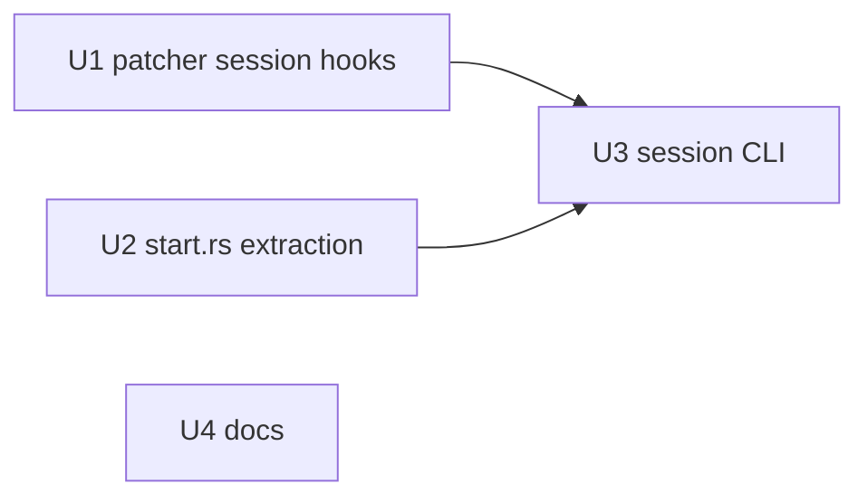

# feat: `llamastash session <tool> [MODEL]`

## Overview

A new CLI verb that launches a coding tool (Claude Code, Codex, OpenCode, pi, Aider) pointed at a model served by the LlamaStash proxy, for that one run only. It sets the tool's per-run configuration through env vars, CLI flags, or a generated file that only that run loads, then execs the tool. No tool's global config is read-modified-written.

`llamastash session claude` is the same as `source ~/.config/llamastash/claude-code.sh && claude`, with the env vars set on the child process instead of sourced from a file.

## Problem Frame

`llamastash integrations` patches each tool's global config (or writes a sourceable snippet). That changes what the tool does in every later run, and the registered model list is a snapshot of favorites. Users want a one-shot launch: "start Claude Code on the model I just loaded" without editing `~/.claude/settings.json`, `~/.codex/config.toml`, `opencode.json` or `~/.pi/agent/models.json`. TODO.md R16 Batch 11.

## Requirements Trace

- R1. `llamastash session <tool>` supports every CLI tool `init`'s integrations step supports: `claude` (alias `claude-code`), `codex`, `opencode`, `pi`, `aider`. Continue and Zed are out (IDE extension / editor, no per-run config hook). `env-sh` is out (user decision).
- R2. No MODEL: use the most recently started running chat launch.
- R3. MODEL given: an alias (`proxy.aliases`), a model reference, or `<model>@<preset>`. Start it if it is not running and wait until Ready.
- R4. The tool uses the model only for that run: no global tool config file is written by llamastash.
- R5. Extra args after `--` reach the tool unchanged.
- R6. Docs ship with the code (`docs/usage.md`, `CHANGELOG.md`, `TODO.md`, README if it lists commands).

## Scope Boundaries

- No changes to `init` / `integrations` behavior or output.
- One model per session. No multi-model registration, no in-tool model switching to other launches.
- No new config keys. No "default model" setting (user removed that from the TODO).
- No `env-sh`/`shell`, Continue (`cn`), or Zed targets.
- Files the tools themselves write as state (Claude Code's `~/.claude.json`, opencode's recent-model state, codex project trust entries) are the tool's behavior, not ours. Document it; do not try to prevent it.

## CLI contract (shared by the implementation and docs units)

```
llamastash session <TOOL> [MODEL] [--dry-run] [--json] [-- <TOOL_ARGS>...]
TOOL: claude | claude-code | codex | opencode | pi | aider
```

Global `--quiet` and `--no-spawn` apply as on other commands.

**Model selection**

| Input | Outcome |
|---|---|
| no MODEL, ≥1 running chat launch (state launching/loading/ready) | the one with the highest launch number (`L<n>`); wait for Ready if not Ready yet |
| no MODEL, none running | exit `66` (`MODEL_NOT_FOUND`): no chat model is running, start one or pass MODEL |
| MODEL matches a `proxy.aliases` name and no catalog model | replace it with the alias target, then continue below (same precedence as the proxy) |
| MODEL resolves (`resolve_model_or_launch`) and a matching launch is running | reuse that launch. A `<model>@<name>` ref needs a launch with that name. A plain ref prefers an unnamed launch of that model, else its latest launch |
| MODEL resolves, nothing running | start it (`@<name>` → preset `<name>`, else the model's default preset, same as plain `start`), wait for Ready |
| MODEL resolves to an embedding/rerank model | exit `64` (`USAGE`): session tools need a chat model |
| MODEL misses | the usual `model_miss` error, exit `66` |
| launch ends in error/stopped, or the wait times out | exit `67` (`LAUNCH_FAILED`) with the cause |
| tool binary not on PATH | exit `70` (`BINARY_NOT_FOUND`): `<program>` not found on PATH |

The id given to the tool is the row's published id (`launch::resolve::published_ids`, the `/v1/models` rule) plus `@<name>` when the chosen launch is named. Without the suffix the proxy would auto-start a second, unnamed copy.

Context window given to the tool: the launch's `resolved_ctx`, else `params.ctx`, else the catalog `native_ctx` (the existing `PatchModel` fallback covers none).

**Launch**: inherit the parent env, set the tool's env, remove the tool's `env_remove` vars, run `program <tool args> <TOOL_ARGS>`. Unix: `exec` (the process becomes the tool, exit code is the tool's). Windows: spawn, wait, exit with the child's code. A one-line note on stderr before launch (`claude → Qwen3.8-27B@coder (L3, ctx 262144)`), suppressed by `--quiet`.

**`--dry-run`**: resolve everything, start nothing, write nothing, launch nothing. A not-running MODEL is reported with `running: false` and catalog figures. Human output: one shell-quoted line, `KEY=value … program args…`. The API key's value prints as `***` when the proxy enforces auth; the keyless `llamastash` stub prints as is. `--json` (only valid with `--dry-run`, clap `requires`) prints:

```json
{
  "tool": "claude",
  "model": "Qwen3.8-27B@coder",
  "launch_id": "L3",
  "running": true,
  "context_window": 262144,
  "program": "claude",
  "args": [],
  "env": { "ANTHROPIC_BASE_URL": "http://127.0.0.1:11435", "ANTHROPIC_AUTH_TOKEN": "***" },
  "env_remove": ["ANTHROPIC_API_KEY"],
  "files": [{ "path": "...", "content": "..." }]
}
```

`launch_id` is `null` when not running. `args` excludes the user's `TOOL_ARGS`, which are listed separately as `"tool_args": [...]`.

**Per-tool launch** (each reuses what its `init` patcher already builds)

| Tool | Program | Args | Env | Files |
|---|---|---|---|---|
| claude | `claude` | none | `ANTHROPIC_BASE_URL`, `ANTHROPIC_AUTH_TOKEN`, `ANTHROPIC_MODEL`, `ANTHROPIC_SMALL_FAST_MODEL`, `CLAUDE_CODE_MAX_CONTEXT_TOKENS`, exactly as `claude-code.sh` exports them. Remove `ANTHROPIC_API_KEY` | none |
| codex | `codex` | `-c model_provider="llamastash"`, `-c model_providers.llamastash={name="LlamaStash", base_url="…", wire_api="responses", env_key="LLAMASTASH_API_KEY"}`, `-c model="<id>"`, `-c model_context_window=<n>`, and `-c model_reasoning_effort="<level>"` for a model with effort levels (the template default, same choice as the profile writer) | `LLAMASTASH_API_KEY` | none |
| opencode | `opencode` | none | `OPENCODE_CONFIG_CONTENT` = JSON with the `provider.llamastash` block the patcher builds (one model), `"model": "llamastash/<id>"`, `"small_model": "llamastash/<id>"`. Plus `LLAMASTASH_API_KEY` (the block references `{env:LLAMASTASH_API_KEY}`) | none |
| pi | `pi` | `-e <file>`, `--provider llamastash-session`, `--model <id>` | `LLAMASTASH_API_KEY` | `<cache dir>/sessions/pi-<hash>.ts`: an extension whose default export calls `pi.registerProvider("llamastash-session", <provider JSON>)`. The provider JSON is the pi patcher's provider block for the one model, with `apiKey` set to `"$LLAMASTASH_API_KEY"`. `<hash>` is a short content hash so concurrent sessions never overwrite each other's file |
| aider | `aider` | none | `AIDER_MODEL=openai/<id>`, `AIDER_OPENAI_API_BASE`, `AIDER_OPENAI_API_KEY` (the patcher's three keys, as Aider's env names) | none |

## Context & Research

### Relevant Code and Patterns

- `src/init/external/mod.rs`: `ToolPatcher` trait, `PatchContext`, `PatchModel::from_catalog_row`, `declared_context` / `declared_output`.
- `src/init/external/tools/claude_code.rs`: `anthropic_base`, `declared_window`, `raw_body` (env lines to share with session).
- `src/init/external/tools/codex.rs`: `PROFILE`, `toml_str`, `effort_to_write`, `raw_body_from` (provider values to share).
- `src/init/external/tools/opencode.rs`: `build_additions` (provider block with `model_entry`), `{env:LLAMASTASH_API_KEY}` via `env_sh::API_KEY_VAR`.
- `src/init/external/tools/pi_dev/mod.rs`: `build_additions` (provider block, `thinking_level_map`).
- `src/init/external/tools/aider.rs`: `build_additions` (`openai-api-base`, `openai-api-key`, `model`).
- `src/init/external/proxy_url.rs`: `resolve` / `from_running_daemon` for the proxy base URL.
- `src/cli/api_key.rs`: key resolution (`config.proxy.effective_api_key()`, `KEYLESS_STUB`) and a small `--json` printer.
- `src/cli/start.rs`: `handle`, `select_start_row`, `fetch_preset_params`, `build_payload`, `wait_and_emit` (the poll loop to extract).
- `src/cli/resolve.rs`: `fetch_catalog`, `fetch_status`, `RunningRow`, `resolve_model_or_launch`, `running_index`.
- `src/launch/resolve.rs`: `published_ids`, `parse_named_reference`, `name_matches`.
- `src/config/loader.rs`: `ProxyAliases` / `ProxyAlias`. Check how `src/proxy/route.rs` applies aliases (an alias answers only when the string matches no model) and reuse that helper if one exists.
- `src/cli/exit_codes.rs`: `USAGE`, `MODEL_NOT_FOUND`, `LAUNCH_FAILED`, `BINARY_NOT_FOUND`.
- `src/cli/cli_args.rs` + `src/cli/mod.rs`: `Command` enum and dispatch; `IntegrationsArgs` / `ApiKeyArgs` as shape references.
- `which = "8"` is already a dependency.
- Integration test patterns: `tests/cli_integration_test.rs`, `tests/start_model_ipc_test.rs` (temp state dir, fake llama server, spawning the CLI binary).

### External facts (verified 2026-10-18)

- Claude Code 2.1.302 (latest): the env vars above are what `claude-code.sh` already sets.
- Codex 0.163.0 (latest, `rust-v0.163.0`): `-c key=value` overrides parse the value as TOML and take dotted paths. `ModelProviderInfo` has `name`, `base_url`, `env_key`, `auth`, `wire_api` (`codex-rs/model-provider-info/src/lib.rs`). Installed at `~/.npm-global/bin/codex`, not on PATH by default.
- OpenCode 1.19.3 (latest): `OPENCODE_CONFIG_CONTENT` is merged after global and project config (`packages/opencode/src/config/config.ts`, about line 482). With it set, opencode does not seed the global config file (about line 264).
- pi 1.3.0 (latest): `--extension/-e <path>` loads an extension file; `pi.registerProvider(name, config)` in the factory registers a provider before startup model selection (`docs/custom-provider.md`); `apiKey: "$VAR"` is the env-reference form. `--provider` + `--model`.
- Aider 0.86.2 (latest on PyPI): `AIDER_OPENAI_API_BASE`, `AIDER_OPENAI_API_KEY`, `AIDER_MODEL`. configargparse precedence is CLI > env > config file.

## Key Technical Decisions

- **Per-tool launch lives in each patcher, behind one new `ToolPatcher` method** (e.g. `session(&ctx, files_dir) -> Option<SessionLaunch>`, default `None`). Each tool already builds its provider block from a `PatchContext`. The session form is a small override of that output, so the two cannot drift. `SessionLaunch` holds program, args, env pairs, env vars to remove, and files to write.
- **Claude Code env has one source.** Refactor `claude_code.rs` so the `.sh` writer and the session read the same list of `(name, value)` pairs.
- **Codex provider values have one source.** Share the provider fields and model/effort choice between `raw_body_from` and the `-c` args. The session uses `env_key` rather than the profile's `auth` command, because the `llamastash` on PATH may not be the binary running the session.
- **The key travels in the child's env only.** Never as a CLI arg (visible in `ps`) and never in a written file. The pi extension file holds no secret.
- **A `SessionTool` clap `ValueEnum`** maps to patcher ids (`claude` and `claude-code` → `claude-code`). This gives help text and shell completions for free. A unit test asserts every variant maps to a registered patcher whose `session` returns `Some`.
- **Reuse `start`'s pieces, don't fork them.** Extract from `src/cli/start.rs` (a) starting a catalog row with an optional preset and (b) the Ready poll loop now inside `wait_and_emit`. `start`'s output and behavior stay byte-identical.
- **pi uses a separate provider name, `llamastash-session`.** That keeps it apart from the `llamastash` provider `init` may have written to `models.json`.
- **exec on Unix.** Signals and the TTY go straight to the tool, and nothing of llamastash stays resident.
- **`--dry-run` never starts a model or writes a file.** Agents and tests can inspect the exact launch with no side effects.

## Open Questions

### Resolved During Planning

- Which tools: claude, codex, opencode, pi, aider (user).
- Active model: latest started (user). The launch number is the order, since launch ids are never reused.
- Model not running: start and wait. Gives the real context size and surfaces load errors before the tool opens.
- Install codex + aider for E2E: done (user approved).

### Deferred to Implementation

- Whether pi needs `--models llamastash-session/<id>` as well, when the user's `enabledModels` scope would otherwise hide the model. Check in E2E.
- Whether pi's `--model` treats a `:suffix` in an Ollama-style id (`gemma4:e2b`) as a thinking level. If it does, note it in docs; no workaround needed now.
- Whether Aider stops at an interactive "unknown model" prompt on a fresh model. If it blocks a `--message` run in E2E, add `--no-show-model-warnings` to its args and say why in a comment.
- Codex: dotted-key `-c model_providers.llamastash.*` vs one inline-table `-c`. Use the inline table unless codex 0.163.0 rejects it live.
- Exact helper names and where the alias lookup helper lives.
- A daemon with the proxy disabled or not listening: fail before launch with a message that says so, using the closest existing exit code. Document the code chosen.

## High-Level Technical Design

> *This illustrates the intended approach and is directional guidance for review, not implementation specification. The implementing agent should treat it as context, not code to reproduce.*

```
session(tool, model_ref?, dry_run, json, tool_args):
  client  = connect_or_spawn
  catalog = fetch_catalog; status = fetch_status
  launch  = model_ref
              ? resolve_alias → resolve_model_or_launch → running match | (dry_run ? none : start + wait)
              : latest chat launch in status (wait if not Ready) | error 66
  refuse non-chat (64)
  model   = PatchModel::from_catalog_row(row, published_id[+@name]) with ctx from the launch
  ctx     = PatchContext { proxy_base_url, api_key, models: [model] }
  launch  = patcher(tool).session(&ctx, cache_dir/sessions)
  dry_run ? print(launch) : { write launch.files; which(program) or 70; exec(program, args + tool_args, env) }
```

## Implementation Units



U1 → U2 → U3 run in one lane, in that order. U4 is docs only and can run in parallel from this plan's CLI contract. It shares no files with U1–U3.

- [x] **Unit 1: `ToolPatcher::session` and the five tool launches**

**Goal:** Each supported patcher can describe a per-run launch for one model.

**Requirements:** R1, R4

**Dependencies:** None

**Files:**
- Modify: `src/init/external/mod.rs` (the `SessionLaunch` type and the trait method with a `None` default)
- Modify: `src/init/external/tools/claude_code.rs`, `src/init/external/tools/codex.rs`, `src/init/external/tools/opencode.rs`, `src/init/external/tools/pi_dev/mod.rs`, `src/init/external/tools/aider.rs`
- Test: inline `#[cfg(test)]` modules in those files

**Approach:**
- Follow the per-tool table in the CLI contract.
- claude: factor the env pairs out of `raw_body`; the `.sh` body is generated from the same pairs (its output must stay byte-identical; the existing tests pin it).
- codex: share provider field values and the model/effort pick with `raw_body_from`. TOML values in `-c` go through `toml_str`.
- opencode / pi / aider: build from `build_additions(ctx)` and override only what differs (pi's `apiKey`, opencode's added `model` / `small_model`, aider's key → env-name mapping).
- pi file: TS default export calling `registerProvider`; name from a short content hash (blake3 is already a dependency) under the `files_dir` passed in.
- Continue, Zed, env-sh keep the default `None`.

**Patterns to follow:** existing `build_additions` / `raw_body` tests and `PatchContext::fixture`.

**Test scenarios:**
- Happy path: claude session env equals the `export` lines of `raw_body` for the same ctx (same names, same values); `env_remove` has `ANTHROPIC_API_KEY`.
- Happy path: claude `.sh` output unchanged (existing tests stay green).
- Happy path: codex args carry `model_provider`, the provider table with `env_key = "LLAMASTASH_API_KEY"` and `wire_api = "responses"`, `model`, `model_context_window`; env has `LLAMASTASH_API_KEY` = ctx key.
- Edge case: codex with an effort model adds `model_reasoning_effort` = the template default; without effort levels it adds none.
- Edge case: codex TOML quoting survives an id with `"` or `\`.
- Happy path: opencode `OPENCODE_CONFIG_CONTENT` parses as JSON, has `provider.llamastash.models.<id>` with the same `limit` the patcher writes, and `model` / `small_model` = `llamastash/<id>`.
- Happy path: pi returns one file under `files_dir` whose content contains `registerProvider("llamastash-session"` and `"$LLAMASTASH_API_KEY"`, and args `-e <that path> --provider llamastash-session --model <id>`.
- Edge case: pi file name is stable for identical input and differs for a different model.
- Happy path: aider env has `AIDER_MODEL=openai/<id>`, `AIDER_OPENAI_API_BASE`, `AIDER_OPENAI_API_KEY`.
- Error path: no launch carries the API key in `args` or in file contents when the key is a real secret.
- Edge case: Continue, Zed and env-sh return `None`.

**Verification:** `cargo nextest run --features test-fixtures --lib init::external` passes.

- [ ] **Unit 2: reusable start-and-wait in `start.rs`**

**Goal:** `session` can start a catalog row (optional preset) and wait for Ready without duplicating `start`.

**Requirements:** R3

**Dependencies:** None (lands before U3)

**Files:**
- Modify: `src/cli/start.rs`
- Test: inline tests in `src/cli/start.rs`

**Approach:**
- Extract the Ready poll loop from `wait_and_emit` into a `pub(crate)` helper that returns the settled `RunningRow` (or none on timeout, or the poll error). `wait_and_emit` calls it.
- Expose a `pub(crate)` way to start a row with an optional preset using the same steps `handle` uses (preset fetch, `build_payload`, `start_model`, `map_start_error`). Keep `handle`'s output byte-identical.

**Patterns to follow:** current `handle` / `wait_and_emit` flow.

**Test scenarios:**
- Test expectation: behavior-preserving refactor. Existing `start` unit tests and `tests/start_model_ipc_test.rs` / `tests/cli_integration_test.rs` stay green. Add a unit test for the extracted poll helper only if it can run without a daemon.

**Verification:** `cargo nextest run --features test-fixtures --lib start` and `--test cli_integration_test` pass.

- [ ] **Unit 3: the `session` command**

**Goal:** `llamastash session <tool> [MODEL] [--dry-run] [--json] [-- args]` as specified in the CLI contract.

**Requirements:** R1–R5

**Dependencies:** Unit 1, Unit 2

**Files:**
- Create: `src/cli/session.rs`
- Modify: `src/cli/cli_args.rs` (`SessionArgs`, `SessionTool` ValueEnum, `Command::Session`, parse tests)
- Modify: `src/cli/mod.rs` (module and dispatch)
- Test: inline tests in `src/cli/session.rs` and `src/cli/cli_args.rs`; create `tests/session_cli.rs` (Unix only)
- Modify if it pins the subcommand list: `tests/cli_completions.rs`

**Approach:**
- Model selection exactly as the contract's table. Alias lookup uses the proxy's rule (reuse its helper if there is one).
- Build one `PatchModel` from the catalog row with the published id (plus `@<name>`) and the launch's context.
- Proxy base URL from the running daemon (`proxy_url`), key as `api_key.rs` resolves it.
- Files written atomically (`util::atomic_write`) before launch; `which::which` for the program; Unix `exec`, Windows spawn+wait.
- `--json` requires `--dry-run`.

**Test scenarios:**
- Happy path (unit): latest-started pick: rows L2 (ready, chat), L5 (loading, chat), L7 (ready, embedding) → L5.
- Edge case (unit): only embedding/rerank rows running → `MODEL_NOT_FOUND`.
- Edge case (unit): plain ref with an unnamed and a named launch of the same model → the unnamed one; with only a named launch → that one, and the id gets `@<name>`.
- Edge case (unit): `<model>@<name>` with no launch of that name and `--dry-run` → `running: false`, nothing started.
- Edge case (unit): an alias whose name is also a model's name → the model wins.
- Error path (unit): an embedding MODEL → `USAGE`.
- Happy path (parse): `session claude`, `session claude-code qwen`, `session pi qwen@coder -- -p hi` → tool, model, tool_args as expected; `--json` without `--dry-run` is a usage error; an unknown tool is a usage error listing the valid ones.
- Integration (`tests/session_cli.rs`): with a temp state dir, a fake model started, and a fake `claude` script first on PATH that writes its argv and env to a file: `session claude -- --foo` execs it, the file shows `ANTHROPIC_BASE_URL` pointing at the test proxy, `ANTHROPIC_MODEL` = the published id, no `ANTHROPIC_API_KEY`, and `--foo` as the last arg.
- Integration: `session codex --dry-run --json` prints the contract's JSON shape (keys present, `launch_id` set, key value `***` only under enforced auth).
- Integration: fake tool missing from PATH → exit `70`.

**Verification:** unit, parse and `--test session_cli` pass; `make lint` clean.

- [ ] **Unit 4: docs**

**Goal:** Users and agents can find and use `session`.

**Requirements:** R6

**Dependencies:** None (written from this plan's CLI contract; the reviewer checks it against the code)

**Files:**
- Modify: `docs/usage.md` (new `### llamastash session <tool> [model]` section after `llamastash integrations`; synopsis, model selection, per-tool table, `--dry-run` / `--json` shape, exit codes, examples `llamastash session claude`, `llamastash session pi qwen@coder -- -p "hi"`, `llamastash session codex -- exec "hi"`; the note that llamastash writes no tool config and which state files the tools write themselves; a pointer from the `integrations` section)
- Modify: `docs/usage.md` § Exit codes, if it lists commands per code
- Modify: `CHANGELOG.md` (one line under `[Unreleased]`)
- Modify: `TODO.md` (strike the Batch 11 item: done, link this plan)
- Modify: `README.md` and `docs/architecture.md` only where they list CLI commands or `src/cli/` modules

**Test expectation:** none, docs only.

**Verification:** every flag, exit code and JSON key in the docs matches the CLI contract above.

## System-Wide Impact

- **Interaction graph:** new CLI verb only. Uses existing IPC (`list_models`, `status`, `presets_show`, `start_model`). No daemon or proxy change.
- **Error propagation:** CLI errors map to the existing exit codes. Once the tool is exec'd, its exit code is the process's.
- **State lifecycle:** the pi extension files accumulate in the cache dir, one per distinct (model, ctx, URL) content. Small and content-addressed; no cleanup needed now.
- **API surface parity:** `init` / `integrations` output stays byte-identical (U1 refactors share code with them; their tests guard it).
- **Unchanged invariants:** no tool global config is written. `start` output unchanged.

## Risks & Dependencies

| Risk | Mitigation |
|---|---|
| A tool changes its per-run hook (env name, flag) in a later release | Versions pinned in docs and in the patcher module comments, as the existing patchers do |
| `exec` hides llamastash errors after launch | All checks (binary, model, files) happen before `exec` |
| E2E touching the user's live daemon | Isolated `LLAMASTASH_STATE_DIR` plus a non-default proxy port in every command |
| A tool writes its own global config during E2E | Checksum the config files before and after; report any change and which tool made it |

## Verification

Setup in the worktree: `export CARGO_HUSKY_DONT_INSTALL_HOOKS=true` (cargo-husky fails in a fresh worktree otherwise).

Automated:
- `cargo nextest run --features test-fixtures --lib init::external`
- `cargo nextest run --features test-fixtures --lib session` and `--lib start` and `--lib cli_args`
- `cargo nextest run --features test-fixtures --test session_cli --test cli_integration_test --test cli_completions`
- `make lint`
- The pre-push hook runs the full suite; don't run it by hand.

End-to-end (required, real tools, real proxy). Never touch the user's daemon: set `LLAMASTASH_STATE_DIR` to one fixed temp dir in **every** shell command (env does not persist between commands), and start that daemon on a non-default proxy port.
1. `cargo build --bin llamastash`; `target/debug/llamastash daemon start --proxy-port 11545` (with the isolated state dir).
2. Start `gemma-3-1b-it-Q4_K_M` with `--ctx 32768` on CPU only (find the GPU-layers knob with `llamastash knobs`). The user's own daemon holds the 4 GiB GPU.
3. Record sha256 of `~/.claude/settings.json`, `~/.codex/config.toml`, `~/.config/opencode/opencode.json` / `.jsonc`, `~/.pi/agent/models.json`, `~/.pi/agent/settings.json`, `~/.aider.conf.yml` (whichever exist).
4. For each tool: `--dry-run --json`, then a real one-shot run. `PATH="$HOME/.npm-global/bin:$PATH"` for codex.
   - `session claude -- -p "Reply with ok"`
   - `session codex -- exec --skip-git-repo-check "Reply with ok"`
   - `session opencode -- run "Reply with ok"`
   - `session pi -- -p "Reply with ok"`
   - `session aider -- --message "Reply with ok" --yes-always --no-git --no-check-update` (in a temp dir)
   - After each, `llamastash requests --json` (isolated state dir) shows a new row for the session's model id. A model reply, or an engine error row naming that model, both prove routing; record which.
5. Re-check the checksums. Any change: name the file and the tool that wrote it.
6. One run with no MODEL arg (latest-started pick) and one with an `@preset` or alias ref if the config has one.
7. Stop the isolated daemon.

## Definition of Done

- All units checked, automated verification green, E2E results recorded in the final report (tool versions included).
- `TODO.md` Batch 11 item struck with a link to this plan.

## Sources & References

- `TODO.md` § R16 Batch 11
- `docs/plans/2026-10-16-001-feat-r15-batch7-plan.md` (Claude Code context window)
- External: Codex `rust-v0.163.0` `codex-rs/model-provider-info/src/lib.rs`; OpenCode `v1.19.3` `packages/opencode/src/config/config.ts`; pi 1.3.0 `docs/custom-provider.md`, `docs/extensions.md`; Aider 0.86.2 `--help`.
